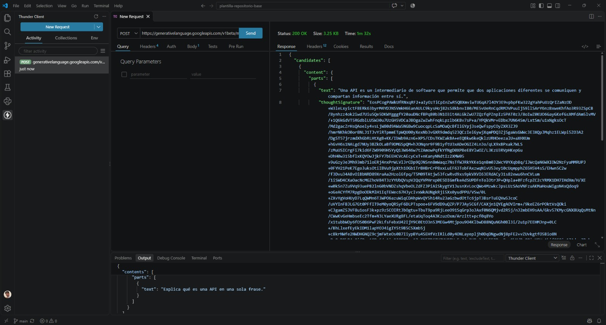

# Primera petición autenticada a Gemini

- Fecha de ejecución: 25/10/2026
- Herramienta: Thunder Client
- Método: POST
- Endpoint: https://generativelanguage.googleapis.com/v1beta/models/gemini-3.8-flash:generateContent
- Modelo: gemini-3.8-flash
- Estado HTTP: 200 OK

## Pregunta enviada

Explica qué es una API en una sola frase.

## Respuesta recibida

Una API es un intermediario de software que permite que dos aplicaciones diferentes se comuniquen y compartan información entre sí.

## Evidencia

## Credencial

La credencial se guarda localmente en .env, excluido mediante .gitignore.